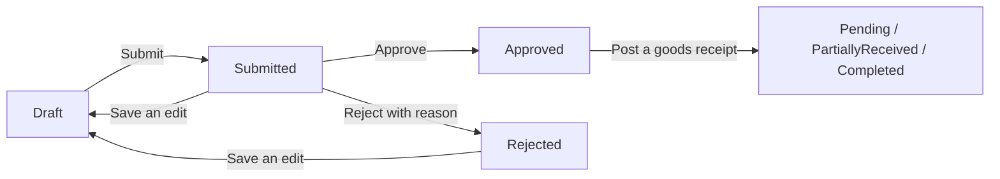

# Inventory Management System

An inventory application built with Angular, ASP.NET Core, and SQL Server. It covers product setup, purchasing, goods receiving, and warehouse stock.

## Features

- Products, categories, packaging, barcodes, and units of measure
- Suppliers, warehouses, and storage locations
- Purchase orders with approval, rejection, cancellation, and printable views
- Partial and full goods receipts, receipt reversal, and stock transactions
- Purchase-order emails with background delivery and status tracking
- Dashboard with product counts, low-stock indicators, stock valuation, and recent transactions
- Company records and company-scoped inventory data
- Cookie-based authentication using ASP.NET Core Identity and JWT tokens

Reporting, approval history, and additional management features are still planned.

## Authentication and company access

Access and refresh tokens are stored in HttpOnly cookies. Protected inventory endpoints require authentication. Purchase-order approval and rejection require the `Administrator` or `SuperAdmin` role; role restrictions for other management operations are still planned.

Unsafe controller requests require an antiforgery token, including login, refresh, and logout. Angular gets the token and sends it in `X-XSRF-TOKEN`. Missing or invalid tokens return HTTP 400. The antiforgery cookie requires HTTPS. See [API client setup](#csrf-requirements-for-api-clients) below for manual requests.

Credentialed browser requests are limited to `Cors:AllowedOrigins`. Development allows `http://localhost:4200` and `https://localhost:4200` by default.

EF Core query filters scope inventory records to the current company. New company-aware records inherit that company when one is not supplied. Currently, both `Administrator` and `SuperAdmin` bypass these filters, as does a request without an authenticated user context. Company-boundary checks and administrator scope still need further work.

The persistence layer also records who created or modified auditable records and when.

## Project structure

The backend is split into Domain, Application, Infrastructure, and API projects. Application contains commands, queries, validation, and service interfaces. Infrastructure provides database access, Identity, and external services. The Angular client lives in a separate project.

The email worker runs in the API process and uses a SQL Server outbox and RabbitMQ queue.

```text
src/
├── InventoryManagementSystem.Domain/          # Entities and domain models
├── InventoryManagementSystem.Application/     # Commands, queries, validators, interfaces
├── InventoryManagementSystem.Infrastructure/  # EF Core, Identity, migrations, services
├── InventoryManagementSystem.Api/             # Controllers, middleware, API configuration
└── InventoryManagementSystem.Client/          # Angular pages, models, services, UI
```

## Technology stack

| Layer | Technologies |
| :--- | :--- |
| **Frontend** | Angular 20, TypeScript 5.9, RxJS, PrimeNG 20, PrimeIcons, Tailwind CSS 4 |
| **Backend** | C#, ASP.NET Core / .NET 10, MediatR, FluentValidation |
| **Database** | SQL Server, Entity Framework Core 10 |
| **Authentication and security** | ASP.NET Core Identity, JWT bearer authentication, HttpOnly cookies, global antiforgery validation, trusted-origin CORS |
| **Messaging and email** | RabbitMQ.Client 7, BackgroundService, database outbox, MailKit, configurable SMTP transport |
| **Local infrastructure** | Docker Compose for RabbitMQ with a persistent data volume |
| **API tooling** | OpenAPI, Scalar |
| **Data and documents** | ExcelJS, SheetJS, ClosedXML, CsvHelper, JsBarcode |
| **Frontend test tooling** | Jasmine, Karma |

## Purchase-order workflow

Purchase orders track approval separately from receiving progress:



- New orders begin with **Draft** approval status and **Pending** receiving status. The server generates the order number and calculates totals from the order lines.
- Administrators and SuperAdmins can approve or reject a Submitted order. Rejection requires a trimmed reason of 1–500 characters; the order records the actor and time for approval or rejection.
- Editing a Submitted or Rejected order returns it to Draft for resubmission. Approved and Cancelled orders cannot be edited. The latest rejection details remain visible after resubmission.
- New goods receipts require an Approved, non-cancelled order with outstanding quantities. Partial receipts update receiving progress; receipt reversal adjusts received quantities and stock.
- Cancellation requires a reason and is limited to unreceived orders. Active receipts prevent order deletion and supplier changes.
- Order references must belong to the order's company, and non-base purchase units require an active positive UOM conversion. Received quantities are maintained by receipts rather than editable order inputs.
- SQL Server transaction locks coordinate changes to the same order. Create and receipt retries use idempotency keys. These locks preserve receiving invariants; stale header edits still require a separate edit-version policy.

The workflow currently records document metadata rather than a full approval-event history. Separation between the creator and approver is a future policy decision.

## Purchase-order email

Sending a purchase-order email saves the recipient, subject, and body in the database. The background worker queues the request through RabbitMQ, sends it through SMTP, and updates its status. The client polls for Pending, Sending, Sent, or Failed.

| Behavior | Implementation |
| :--- | :--- |
| **Request acceptance** | `POST /api/process/purchase-orders/{id}/send-email` persists an outbox request and returns HTTP 202 |
| **Status lookup** | `GET /api/process/purchase-orders/{id}/emails/{emailId}` returns the company-filtered request status |
| **Deduplication** | Reusing an `Idempotency-Key` UUID for the same purchase order returns the original request and email snapshot |
| **Broker recovery** | Pending database rows remain available when RabbitMQ is down |
| **Retry policy** | Eligible pre-send connection failures and SMTP 4xx rejections receive up to three attempts, with 30- and 60-second retry delays |
| **Uncertain delivery** | Failures during sending and stale Sending requests require delivery review before resubmission |

`Sent` means the SMTP server accepted the message; it does not guarantee inbox delivery. SMTP and SQL Server cannot commit atomically, so the worker does not promise exactly-once delivery. Check uncertain outcomes before sending a new request. The UI retains its idempotency key for request retries within the current component instance; clients needing retries across reloads must persist that key.

## Run locally

### Prerequisites

- .NET 10 SDK
- Node.js compatible with the Angular CLI version in the client lockfile
- npm
- A running SQL Server instance with permission to create or migrate the application database
- For background email: Docker Desktop with Linux containers, or another RabbitMQ broker, plus SMTP connection settings

### 1. Clone the repository

```bash
git clone https://github.com/Sitt-Paing/InventoryManagementSystem.git
cd InventoryManagementSystem
```

### 2. Configure the API

Use local .NET user secrets for the connection string and development administrator. The following commands run from the repository root; replace the example values for your environment.

```powershell
dotnet user-secrets set "ConnectionStrings:DefaultConnection" "Server=localhost;Database=InventoryManagement;Trusted_Connection=True;TrustServerCertificate=True" --project src/InventoryManagementSystem.Api
dotnet user-secrets set "JwtSettings:SecretKey" "replace-with-your-own-random-secret-at-least-32-characters" --project src/InventoryManagementSystem.Api
dotnet user-secrets set "DefaultAdmin:UserName" "localadmin" --project src/InventoryManagementSystem.Api
dotnet user-secrets set "DefaultAdmin:Email" "localadmin@example.com" --project src/InventoryManagementSystem.Api
dotnet user-secrets set "DefaultAdmin:Password" "replace-with-your-own-strong-password" --project src/InventoryManagementSystem.Api
```

Choose an administrator password containing uppercase and lowercase letters and a digit, with at least six characters. On a fresh Development database, startup applies migrations for both database contexts and seeds administrator roles and the configured administrator. Existing users are not overwritten by changing seed settings. Check startup logs if database initialization fails.

### 3. Start the backend

```powershell
dotnet dev-certs https --trust
dotnet restore src/InventoryManagementSystem.Api/InventoryManagementSystem.Api.csproj
dotnet run --project src/InventoryManagementSystem.Api --launch-profile https
```

### 4. Start the frontend

In a second terminal:

```bash
cd src/InventoryManagementSystem.Client
npm ci
npm start
```

The development client points to `https://localhost:7152/api` in `src/InventoryManagementSystem.Client/src/environments/environment.ts`.

| Service | Local URL |
| :--- | :--- |
| **Web application** | http://localhost:4200 (use the URL reported by Angular CLI) |
| **API base** | https://localhost:7152/api |
| **API documentation** | https://localhost:7152/docs/scalar |

Sign in with the administrator credentials configured above.

### 5. Optional: enable background purchase-order email

From the repository root, start the included RabbitMQ service:

```powershell
docker compose -f compose.email.yml up -d
```

| RabbitMQ service | Local address |
| :--- | :--- |
| **AMQP** | `localhost:5672` |
| **Management UI** | http://localhost:15672 |

The compose service binds its ports to localhost and persists broker data in a named volume. Local credentials are `guest` / `guest`.

Set `SmtpSettings:Host`, `Port`, `UserName`, `Password`, `FromEmail`, `FromName`, and `UserStartTls` through user secrets or environment variables. `UserStartTls` is the configuration key used by the code. Use your SMTP provider's connection settings and your own test recipient when trying the send action.

Configure `RabbitMqEmail:Enabled` as `true` and restart the API. Development configuration already enables the worker. Broker settings are `Host`, `Port`, `UserName`, `Password`, `VirtualHost`, and `Queue` under `RabbitMqEmail`; the defaults target the local broker and the `inventory.purchase-order-emails` queue.

For example, enable the worker through local user secrets:

```powershell
dotnet user-secrets set "RabbitMqEmail:Enabled" "true" --project src/InventoryManagementSystem.Api
```

Use deployment secrets for broker and SMTP credentials in other environments. With the worker disabled, accepted requests remain Pending until an enabled worker processes them. To try the workflow, preview a purchase order addressed to your own test mailbox, select **Send Email**, and follow its status in the dialog.

### CSRF requirements for API clients

Before any POST, PUT, PATCH, DELETE, or other unsafe controller request, call `GET /api/Auth/csrf-token`, retain the response cookies, and send `data.csrfToken` in `X-XSRF-TOKEN`. Obtain a new token after login, logout, or an authentication identity change. This applies to manual API clients and Scalar requests as well as the Angular app, including bearer-authenticated callers.

For a deployed frontend on another origin, configure `Cors:AllowedOrigins` as an array of exact trusted origins, without trailing slashes. Environment variables can use `Cors__AllowedOrigins__0`, `Cors__AllowedOrigins__1`, and so on. Browser restrictions on cross-site cookies still apply.

## Planned work

- [ ] **Reporting:** Add dedicated reporting features.
- [ ] **Expanded management:** Add further management features beyond the existing company and master-data screens.
- [ ] **Purchasing controls:** Add creator/approver separation, approval history, and edit-version conflict handling.

Access-control work:

- [ ] Apply explicit role authorization to privileged management operations.
- [ ] Refine tenant administrator scope and verify company boundaries across reads and writes.


## Development commands

Build the API and its referenced projects from the repository root:

```bash
dotnet build src/InventoryManagementSystem.Api/InventoryManagementSystem.Api.csproj
```

Run the database-free CSRF/CORS integration checks:

```bash
dotnet run --project tests/InventoryManagementSystem.CsrfChecks
```

Run the SQL Server purchase-order integration checks:

```powershell
dotnet run --project tests/InventoryManagementSystem.PurchaseOrderChecks
```

These checks require Windows integrated authentication to the local default SQL Server instance and permission to create and drop a database. They create a uniquely named `IMS_PO_Checks_<UUID>` database and remove it during cleanup. Coverage includes reference validation, quantity precision, numbering, cancellation, idempotent retries, company visibility, and concurrent order/receipt changes. Approval and rejection browser flows require separate verification.

Run frontend commands from `src/InventoryManagementSystem.Client`:

```bash
npm run build
npm test
```

`npm test` launches the configured Karma/Jasmine runner and requires a compatible browser.

Maintained by [Sitt-Paing](https://github.com/Sitt-Paing).
